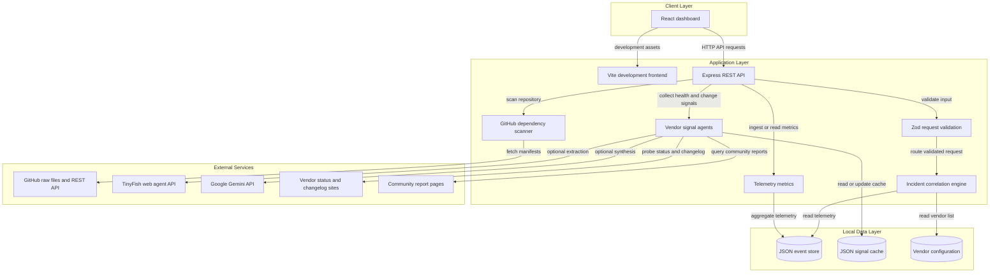
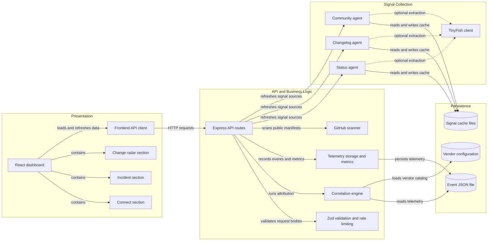

# Architecture Diagram

IncidentPulse AI is a React dashboard backed by an Express API and a deterministic incident-correlation engine. The server stores telemetry and cached signals as JSON and can optionally enrich vendor and incident analysis through external APIs.

## Application Architecture

<!-- mermaid-checked: no \n, no em-dash/en-dash, no {} in labels, subgraphs are id["label"], arrows are -->|"label"|, all subgraphs closed by end, ids unique -->

### Technology Stack Summary

| Layer | Technology | Version | Purpose |
| --- | --- | --- | --- |
| Presentation | React | 19.x | Interactive incident, connection, and change-radar screens |
| Presentation | TypeScript | 7.x | Typed UI and application code |
| Frontend build | Vite | 8.x | Development server and production client build |
| API | Express | 4.21.x | HTTP routes, sample app hosting, and API middleware |
| Validation | Zod | 4.x | Request payload validation |
| Metrics and charts | Recharts | 3.x | Dashboard telemetry visualizations |
| Event storage | Node.js file system and JSON | Node.js runtime | Persist telemetry and cached vendor data |
| External AI | Google Gemini SDK | 2.x | Optional synthesis, extraction, and adversarial counter-check |
| External web agent | TinyFish HTTP API | API v1 | Optional extraction from vendor and community pages |
| Repository scan | GitHub raw content and REST APIs | REST API v3 media type | Read supported dependency manifests from public repositories |

### Data Storage & External Services

The local data layer consists of `data/events.json`, vendor definitions under `config/`, and cached status, changelog, and community files under `data/cache/`. There is no relational database, cache server, or message broker. The repository scanner reads supported manifest files from public GitHub repositories. Vendor agents can query status and changelog sites directly, use TinyFish for web extraction, and optionally use Gemini for signal extraction or incident synthesis. Cached data is used when live signal retrieval is unavailable.

### Key Architectural Decisions

- A deterministic weighted scoring engine owns the base vendor score and attribution rules; optional Gemini synthesis can refine the explanation and reduce confidence after a counter-check.
- JSON files keep the demo self-contained and make sample/replay behavior easy to inspect, but do not provide multi-instance coordination or transactional guarantees.
- Vendor integrations are optional and cached/replay modes are distinguished from live mode in the user interface.

## Component Relationships

<!-- mermaid-checked: no \n, no em-dash/en-dash, no {} in labels, subgraphs are id["label"], arrows are -->|"label"|, all subgraphs closed by end, ids unique -->

### Component Inventory

| Component | Layer | Type | Responsibility |
| --- | --- | --- | --- |
| React dashboard | Presentation | React application | Loads sample and API-backed state and coordinates user actions |
| Connect section | Presentation | UI component | Scans a repository, maps services, and sends a test event |
| Incident section | Presentation | UI component | Displays verdict, confidence, health, evidence, and telemetry |
| Change radar section | Presentation | UI component | Displays and filters vendor changes |
| Frontend API client | Presentation | Fetch helpers | Calls verdict, metrics, signals, scans, replay, and ingestion APIs |
| Express API routes | API | HTTP routes | Exposes dashboard data, telemetry, scan, chat, and replay endpoints |
| Zod validation and rate limiting | API | Middleware and schemas | Validates request payloads and limits telemetry ingestion |
| Correlation engine | Business logic | Scoring service | Scores configured vendors and assembles verdict evidence |
| Telemetry storage and metrics | Data access | JSON persistence and aggregator | Stores up to 5,000 events and calculates timeline metrics |
| GitHub scanner | Integration | Repository adapter | Reads supported manifests and maps known package names to vendors |
| Status agent | Integration | Signal collector | Probes status APIs and uses cached or web-agent results |
| Changelog agent | Integration | Signal collector | Detects and caches relevant vendor documentation changes |
| Community agent | Integration | Signal collector | Collects or loads community outage reports |
| TinyFish client | Integration | HTTP client | Calls optional web extraction API using a server-side key |
| Event JSON file | Persistence | Local JSON store | Holds ingested application events |
| Signal cache files | Persistence | Local JSON cache | Holds last-known vendor, changelog, and community signals |
| Vendor configuration | Configuration | JSON catalog | Defines monitored providers, categories, and source URLs |
