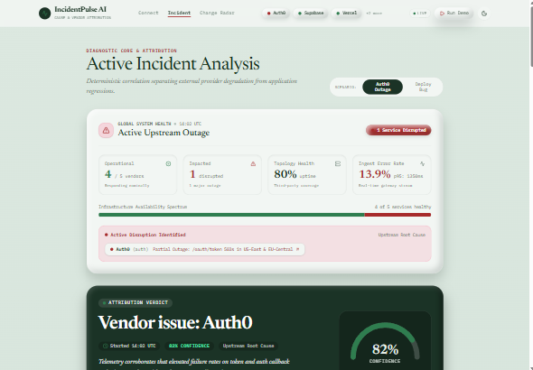
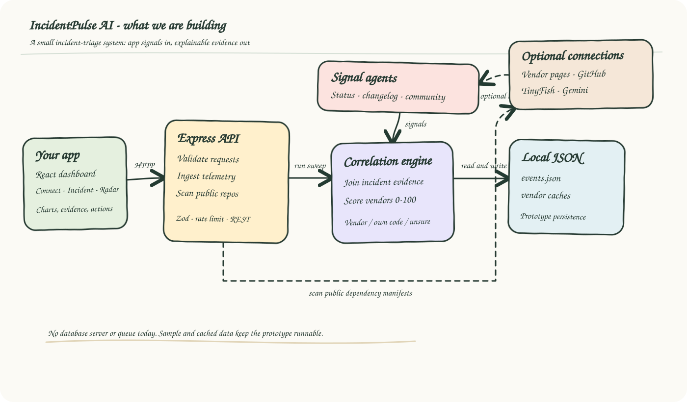
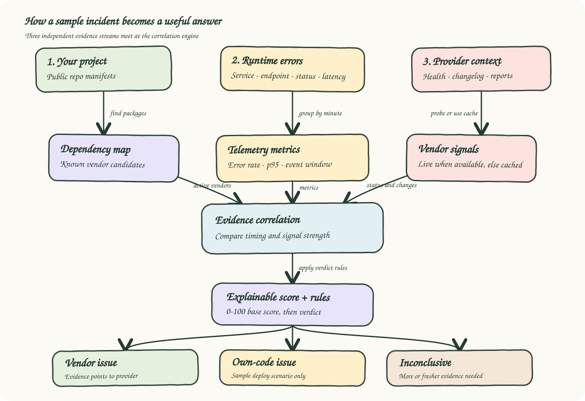
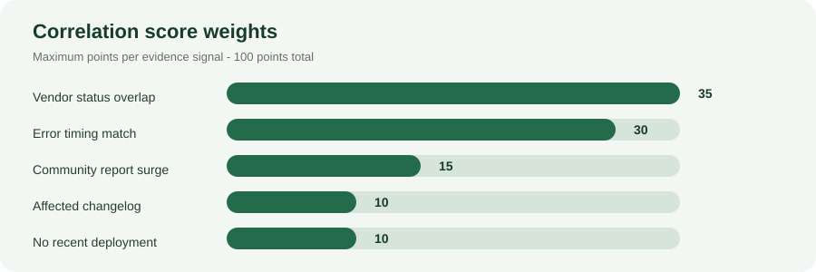

# IncidentPulse AI

IncidentPulse AI is an incident-triage dashboard and API that correlates application error telemetry with third-party service health, community reports, changelog changes, and deployment context. It presents an evidence-linked attribution as **vendor**, **own code**, or **inconclusive**, along with incident metrics and suggested next steps.

> **Prototype scope:** The repository includes deterministic Auth0-outage and deploy-bug scenarios, sample telemetry, and cached vendor signals. The scoring workflow is a prototype, not a guarantee of correct root-cause analysis for arbitrary applications. Review the evidence and validate recommendations before acting on a production incident.

## Dashboard

The screenshot below shows the dashboard in its sample Auth0 outage scenario. Demo values and cached signals are illustrative.



## What we're building

These whiteboard-style diagrams show the current prototype: dependency discovery and application telemetry feed a correlation engine, which combines those inputs with vendor signals and returns an evidence-backed incident view.

### System architecture



### Incident-analysis flow



## What it does

- **Maps a public GitHub repository's dependencies** by reading supported manifests and matching packages against the configured vendor catalog.
- **Accepts application error telemetry** and stores events locally for metric aggregation.
- **Collects vendor signals** from status pages, changelogs, and community reports, using live integrations when configured and cached JSON otherwise.
- **Calculates a weighted attribution score** for each configured vendor and returns evidence, confidence, fix suggestions, sweep logs, and a formatted incident brief.
- **Visualizes incident health** with vendor status, error-rate and latency metrics, evidence, and change-radar cards.
- **Replays a sample incident** or switches between the bundled vendor-outage and deployment-regression scenarios.

The current vendor catalog is Vercel, Supabase, Auth0, Stripe, and AWS S3. Repository scanning currently recognizes selected JavaScript, Python, Go, and Rust manifest files; it is not a complete software bill of materials or source-code analyzer.

## Architecture at a glance

The browser dashboard talks to a single Express server. The server validates API requests, records telemetry, runs the correlation engine, and calls vendor/repository integrations. Events and vendor-agent results are persisted as JSON files; Gemini and TinyFish are optional server-side integrations.

Detailed component relationships and the underlying technical diagrams are documented in the [architecture reference](./.github/modernize/assessment/engines/facts/architecture-diagram.md).

1. Scan a public repository to find supported manifests and map matching packages to configured vendors.
2. Ingest telemetry or load the bundled sample/replay events. The API computes minute-bucketed metrics from stored events when there are enough buckets; otherwise, the UI/API can use the bundled sample timeline.
3. Refresh or read cached vendor status, changelog, and community signals.
4. The correlation engine scores the active vendor candidates, assembles evidence, and applies the configured verdict rules.
5. The API returns the verdict and related data for the dashboard. Gemini can optionally write the explanation and run an adversarial counter-check; the numeric score starts from the deterministic formula.

### Correlation score

The engine's base vendor score is a weighted sum. The criteria below describe the implemented formula; signal quality and freshness still depend on the configured integrations and data.



The hand-drawn-style scoring graphic is a visual summary of the table below; the exact thresholds and criteria are described in the implementation notes.

| Evidence criterion | Maximum points | Current behavior |
| --- | ---: | --- |
| Vendor status overlaps the incident | 35 | Awards points when the status signal is degraded or in a major outage. |
| Error timing matches vendor window | 30 | Matches the configured incident scenario/timing. |
| Community outage-report surge | 15 | Awards points when the report count exceeds the implemented threshold. |
| Relevant changelog update | 10 | Awards points when a change lists affected endpoints. |
| No recent deployment | 10 | Adds points when the scenario has no recent deploy. |
| **Maximum base vendor score** | **100** | Sum of the five criteria above. |

**Verdict rules:** a vendor candidate with a base score of at least 60 can be attributed as the vendor in the vendor-outage scenario. If every vendor scores below 30 and the scenario has a recent deploy, the engine can attribute the issue to own code. Other cases are inconclusive. A configured Gemini counter-check can lower the final confidence by 10 points if it finds a strong counter-hypothesis; Gemini does not originate the base mathematical score.

> **Important implementation detail:** the bundled deployment context is scenario-driven. The GitHub scanner discovers dependencies; it does not currently inspect a real deployment history. The sample fixture's timestamps, incidents, and some evidence are illustrative and should not be treated as live operational truth.

## Technology and data

| Area | Implementation |
| --- | --- |
| Frontend | React 19, TypeScript, Vite 8, Recharts, Tailwind CSS 4, Lucide icons, and Motion |
| Backend | Node.js, Express 4, TypeScript executed with `tsx` |
| Request validation | Zod schemas in the Express server |
| Telemetry persistence | JSON event store in `data/events.json`, capped at the latest 5,000 events |
| Signal cache | JSON files under `data/cache/` |
| Optional AI | Google Gemini via `@google/genai` |
| Optional web extraction | TinyFish Agent API |
| Repository scanning | GitHub raw file endpoints with GitHub REST API fallback |
| Deployment configuration | Vercel configuration in `vercel.json` |

There is no database server or queue in the current implementation. The JSON files are intended for the local prototype and should not be assumed to provide multi-instance coordination, transactional writes, or production-grade retention.

## HTTP API

| Method | Path | Description |
| --- | --- | --- |
| `GET` | `/api/verdict?scenario=auth0` | Compute and return the current verdict. Use `scenario=own_code` for the bundled internal-regression scenario. |
| `POST` | `/api/verdict/run` | Run a correlation sweep; accepts optional `scenario`, `forceReplay`, and `activeVendorIds`. |
| `POST` | `/api/ingest` | Validate, rate-limit, and persist one telemetry event. Returns an event ID and a coarse attribution hint. |
| `GET` | `/api/metrics` | Return minute-bucketed error rates, p95 latency, traffic, and incident markers. |
| `GET` | `/api/telemetry` | Compatibility alias for the metrics timeline. |
| `GET` | `/api/vendors` | Return configured vendors enriched with status. |
| `GET` | `/api/signals` | Aggregate status, changelog, and community signals. |
| `GET` | `/api/changes` | Return vendor changelog updates. |
| `GET` | `/api/sweep-logs?scenario=auth0` | Return correlation sweep log entries. |
| `POST` | `/api/scan` | Scan a public GitHub repository for supported dependency manifests. |
| `POST` | `/api/scan-repo` | Compatibility alias for repository scanning. |
| `POST` | `/api/chat` | Ask the sample SRE copilot; uses Gemini when configured and a sample-specific fallback otherwise. |
| `POST` | `/api/replay/trigger` | Replay the bundled synthetic incident events and run analysis. |
| `GET` | `/sample-app` | Open the included telemetry-emitting sample application. |

### Example: ingest an event

```powershell
$event = @{
  ts = (Get-Date).ToUniversalTime().ToString('o')
  service = 'identity-service'
  dependency = 'Auth0'
  endpoint = '/api/auth/callback'
  statusCode = 503
  latencyMs = 1420
  message = 'Upstream token request failed'
} | ConvertTo-Json

Invoke-RestMethod -Method Post -Uri http://localhost:3000/api/ingest `
  -ContentType 'application/json' -Body $event
```

## Getting started

### Requirements

- Node.js and npm compatible with the installed Vite toolchain.
- Network access is only needed for dependency installation and optional live integrations.

### Install and run

```powershell
git clone https://github.com/KaushikChan2007/IncidentPulse_AI.git
cd IncidentPulse_AI
npm install --legacy-peer-deps
npm run dev
```

Open [http://localhost:3000](http://localhost:3000). `--legacy-peer-deps` is currently needed with npm because the declared Vite and esbuild peer ranges conflict; the project also includes a Bun lockfile.

### Optional credentials

Copy `.env.example` to `.env.local` and set only the credentials for integrations you plan to use. These values are read server-side; do not commit `.env.local`.

| Variable | Required | Used for |
| --- | --- | --- |
| `TINYFISH_API_KEY` | No | Live web-agent extraction for vendor status, changelogs, and community reports. |
| `GEMINI_API_KEY` | No | AI incident explanation and counter-check; the chat endpoint also uses it when available. |
| `GITHUB_TOKEN` | No | Higher GitHub API rate limits while scanning public repositories. |
| `APP_URL` | No | Replay target base URL; example defaults to `http://localhost:3000`. Set it to your deployed app URL when replaying remotely. |
| `PORT` | No | Server port; defaults to `3000`. |

Without credentials or live responses, the application can use the checked-in cache/sample data. The header/footer data mode distinguishes `LIVE`, `CACHED`, and `REPLAY`; cached or replay results are not proof of current external conditions.

## Try the demo

1. Start the server with `npm run dev`.
2. Open the dashboard. The initial UI contains sample incident content while it loads available API data.
3. Use **Auth0 Outage** and **Deploy Bug** to switch between the bundled scenarios.
4. Use **Run Demo** to send synthetic replay events through `/api/ingest` and rerun the engine.
5. Open **Connect** to scan a public repository or send a test event. The bundled `/sample-app` can also emit sample Auth0 and database errors.
6. Open **Radar** to review vendor changelog changes.

The repository scan is read-only and limited to supported manifests in a public GitHub repository; it does not clone or execute the scanned project.

## Development and validation

```powershell
npm run lint        # TypeScript type-check
npm run build       # Production frontend build
npm run test:engine # Deterministic engine scenario check
npm run replay      # Send the bundled replay events to the local API
npm run send:errors # Send sample error events
npm run preview     # Preview the built frontend
```

Architecture diagrams and a component inventory are also available in the [architecture diagram](./.github/modernize/assessment/engines/facts/architecture-diagram.md).

## Repository map

| Path | Purpose |
| --- | --- |
| `src/` | React dashboard, components, frontend data access, and UI types |
| `server.ts` | Express server, REST endpoints, validation, and middleware |
| `lib/engine.ts` | Weighted vendor correlation and verdict synthesis |
| `lib/agents/` | Vendor status, changelog, and community signal collection |
| `lib/github.ts` | Public GitHub manifest scanner and dependency mapping |
| `lib/tinyfish.ts` | Optional TinyFish client |
| `lib/storage.ts` | JSON telemetry event persistence and metric aggregation |
| `config/dependencies.json` | Configured vendor catalog |
| `data/cache/` | Cached vendor status, changelog, and community signals |
| `data/replay/` | Synthetic replay profile |
| `sample-app/` | Small client used to send test telemetry |
| `scripts/` | Engine check, replay, event sender, and vendor probes |
| `docs/` | Scoring graph and dashboard screenshot |

## Limitations and safe use

- Attribution depends on available telemetry and signal quality; a high score is not a guarantee or a substitute for operator review.
- The checked-in data and bundled scenarios are demo fixtures. Some displayed incident details are illustrative.
- The own-code deployment context is simulated; there is no live CI/CD deployment-history integration.
- Repository scanning detects selected manifests and known package-name patterns, not every dependency, runtime call, or data flow.
- JSON persistence is a local prototype store. Use a database and appropriate concurrency, retention, and access controls before a multi-user production deployment.
- Configure API credentials only in the server environment. Never place secrets in frontend variables or commit secret files.
- Review generated remediation suggestions before applying them to production.

## License

No license is currently declared. Obtain the repository owner's permission before redistributing the project.
